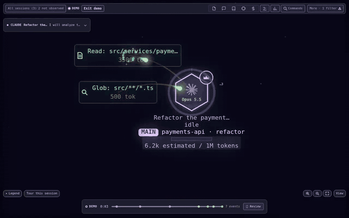
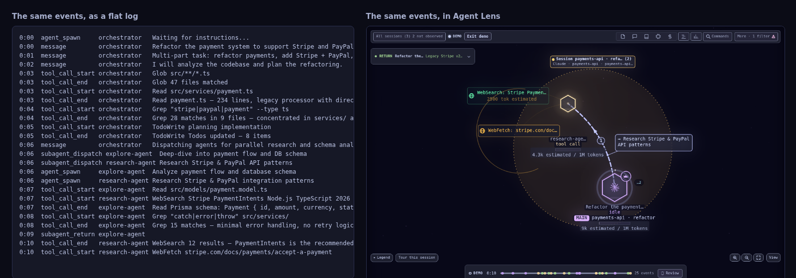
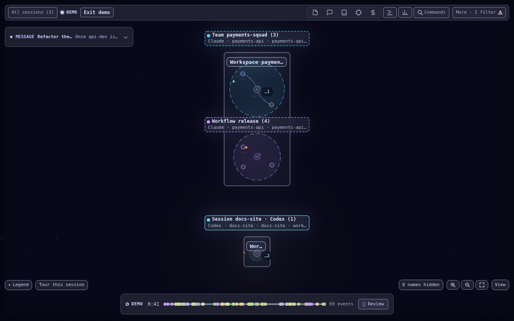
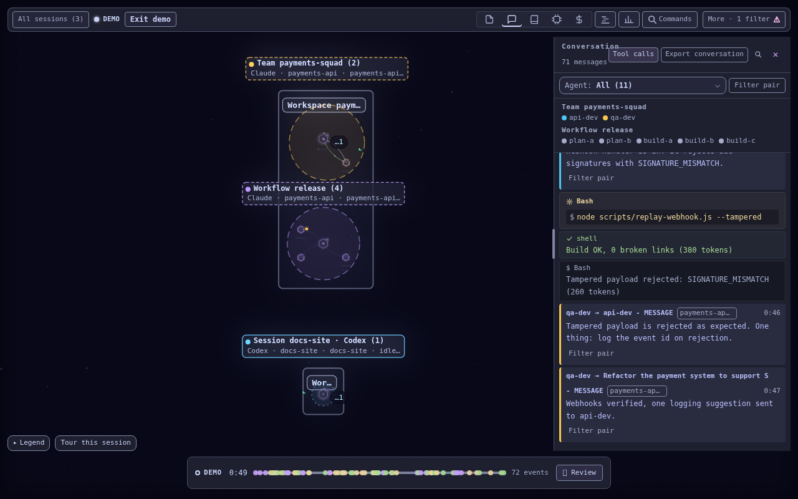
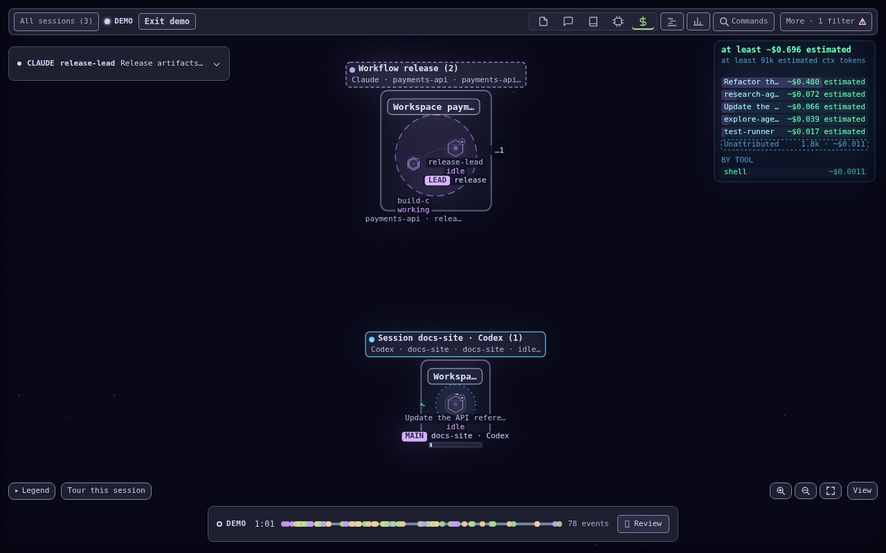

# Agent Lens

[](https://github.com/j0hn-42/agent-lens/actions/workflows/ci.yml)
[](LICENSE)
[](extension/CHANGELOG.md)

**A live canvas of your coding agents.** See what Claude Code, Codex, GitHub Copilot, Pi, Gemini CLI and OpenCode think, which tools they call and how they hand work to each other, as it happens.

*English · [Français](README.fr.md)*



[Watch the tour video](docs/media/tour.mp4) · [Try it without a session](#quick-start): `pnpm run dev:demo`

> Agent Lens is based on [Agent Flow](https://github.com/patoles/agent-flow) by Simon Patole (Apache License 2.0). See [Origin and credits](#origin-and-credits).

## Why Agent Lens?

An agent session is a black box: you see the final result, not the journey. Agent Lens shows the journey, so you can trace the tool calls that led to a failure, spot slow or repeated work, understand how sub-agents coordinate, and learn how your prompts get executed. It reads what the agents leave on your machine and shows only what it can prove: an unknown state reads "Not observed", a partial total reads "at least X".



## Quick start

```bash
git clone https://github.com/j0hn-42/agent-lens.git
cd agent-lens
pnpm i && pnpm run setup && pnpm run dev
```

Open http://localhost:3000 and start a Claude Code, Codex or other agent session in another terminal: events stream to the browser as they happen. No session at hand? `pnpm run dev:demo` plays a tour of every feature on mock data.

Requires [Node.js](https://nodejs.org/) 20+, [pnpm](https://pnpm.io/) and the CLI of at least one runtime above.

## What you see

- **A live canvas**: agents, sub-agents and their tool calls as an interactive graph, with branching and return flows. Click anything to inspect it.
- **Every session at once**: the Fleet (All) view puts every watched session on one canvas, grouped by project, next to a Sessions panel that lists them as a tree.
- **Timeline, Files and Conversation**: the full execution timeline, which files agents touched or edited together, and one conversation for messages and tool calls.
- **Honest values**: nothing is shown that cannot be proven; what is guessed or partial says so ([what each label means](docs/reading-the-ui/honest-values.md)). The views are explained in [Reading the UI](docs/reading-the-ui.md).
- **Replay and demo**: export a session as one offline HTML file with a keyboard scrubber; a guided tour runs on mock data.
- **Nine dark themes and WCAG 2.1 AA**: chosen in **Settings**; accessibility is checked in CI.

<table>
  <tr>
    <td><a href="docs/media/fleet.png"></a></td>
    <td><a href="docs/media/comms.png"></a></td>
    <td><a href="docs/media/cost.png"></a></td>
  </tr>
  <tr>
    <td align="center">Fleet view</td>
    <td align="center">Comms between agents</td>
    <td align="center">Cost, with its limits</td>
  </tr>
</table>

More, with every limit stated, in [Features](docs/features.md): workflows and teams, repeated reads, delegation report, Context panel, quota gauges, headless commands, an MCP server and more.

## Runtimes

Agent Lens watches all of them at once and tags each session with its runtime.

| Runtime | Reads | Known limits |
| --- | --- | --- |
| Claude Code | hooks, plus transcripts in `~/.claude/projects/` | |
| Codex | rollouts in `~/.codex/sessions/` | |
| GitHub Copilot | `~/.copilot/session-state/` | local sessions only, not cloud-hosted ones |
| Pi | `~/.pi/agent/sessions/` | no sub-agents; tokens and cost not read yet |
| Gemini CLI | `~/.gemini/tmp/` | no sub-agents drawn; tokens and cost not read yet |
| OpenCode | its SQLite database, read-only | Linux only so far; sessions of the last 10 minutes |

Cursor is not supported yet. See the [roadmap](docs/roadmap.md) for what is delivered, partial or blocked.

## Install

**From source**: the three commands of the [quick start](#quick-start), or `pnpm run build:app` then `node app/dist/app.js` for the standalone app (serves the UI and the relay, opens the browser; `--port <n>`, `--no-open`, `--all-workspaces`).

**VS Code extension**: build the `.vsix` from source and install it. Works with VS Code 1.85+, [Cursor](https://cursor.sh/) and [Windsurf](https://windsurf.com/).

```bash
pnpm --filter agent-lens run package
code --install-extension extension/agent-lens-<version>.vsix
```

Then run **Agent Lens: Open Agent Lens** from the Command Palette. The full steps, the choice of runtime, the scope of the scanned sessions and the settings are in [Install and configure](docs/install.md) and the [reference](docs/reference.md). Something does not show up? See the [FAQ](docs/faq.md).

## Who it is for

**For** people who run coding agents and want to see what they did: why a session went wrong, where time and tokens went, which files were read again and again.

**Not for**: a hosted service (it runs on your machine and sends no telemetry), an agent framework, or a billing tool (costs are estimates from the tokens a runtime reports, and say so). It observes. Two opt-in features, off by default, can act: [operator control](docs/operator-control.md) in VS Code and [launching an agent](docs/launch-security.md).

## Documentation

- [Features](docs/features.md): each feature, with its limits
- [Install and configure](docs/install.md) and [Reference](docs/reference.md): commands, settings, scripts
- [FAQ and troubleshooting](docs/faq.md)
- [Reading the UI](docs/reading-the-ui.md): views, and what "Not observed", "at least", "estimated" and "unattributed" mean
- [Node inspector](docs/node-inspector.md): model, cost attribution, issue and PR links
- [Canvas performance](docs/performance.md): idle drawing, viewport culling and how to measure them with `?perf`
- [Event sources](docs/relay-sources.md): hooks and JSONL reconciliation, the local server
- [Remote access](docs/remote-access.md): a named tunnel with `--allow-host` and `--token-file`
- [Roadmap](docs/roadmap.md): which runtimes are delivered, partial or blocked, and what remains for remote access, mobile and the tray icon
- [Launching an agent](docs/launch-security.md): the opt-in `--allow-launch` route
- [Sharing state](docs/state-share.md) and the [MCP server](docs/mcp-server.md): give Claude the observations
- [Headless use](docs/headless.md): `ps`, `tail`, `statusline` and webhooks
- [Session export](docs/session-export.md): the standalone HTML replay
- [Demo tour](docs/demo.md): the presenter script that shows every feature on mock data

Contributing (branches, labels, accessibility checks, releases): see [CONTRIBUTING.md](CONTRIBUTING.md).

## Origin and credits

Agent Lens is based on [Agent Flow](https://github.com/patoles/agent-flow), created by [Simon Patole](https://github.com/patoles) for [CraftMyGame](https://craftmygame.com). Agent Flow's code, architecture and original visual design are the foundation of this project, and we are grateful to its author.

This repository is an independent continuation with its own name, icon set, roadmap and maintainers. It is not affiliated with or endorsed by the Agent Flow project. Changes made since the fork are listed in [NOTICE](NOTICE) and in the git history; the history before the fork is Agent Flow's.

## Privacy & Telemetry

Agent Lens sends **no telemetry**: the collection endpoint inherited from Agent Flow was removed, so nothing leaves your machine and nothing is written to disk for analytics. If you want telemetry for your own deployment, set your own endpoint and publishable key in `scripts/telemetry.ts` and rebuild. Telemetry also stays off when `DO_NOT_TRACK=1` or `AGENT_LENS_TELEMETRY=false` is set.

## License

Apache License 2.0, see [LICENSE](LICENSE). The original copyright notices are kept and the modifications are stated in [NOTICE](NOTICE), as the license requires.
