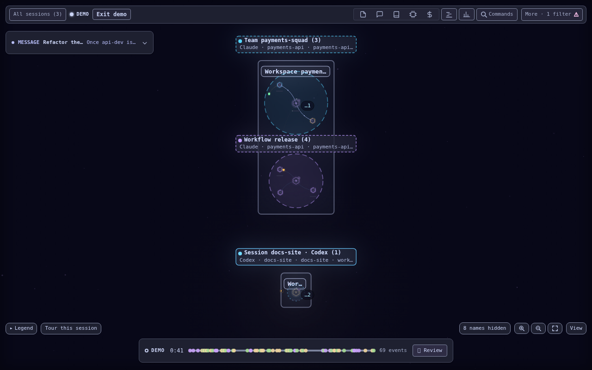

## Views

The picture is the demo tour (`pnpm run dev:demo`) at 0:41; its data is mock data.

- **Fleet / All**: the All view draws every watched session on one canvas. Each session is a dotted halo (its label gives runtime, workspace, status and cost; click it to zoom to the cluster). Sessions of the same project are grouped together.
- **Workspace zones**: when sessions of two or more projects are on the canvas, each project is drawn inside its own neutral rounded rectangle with a solid outline and a header chip ("Workspace payments-api · 2 sessions · 1 team"). A zone is a place, a halo is a group: halos are coloured circles (dotted for a session, dashed for a team or workflow), zones are rectangles that are never coloured by team. A session whose project is not proven (outside git, imported transcripts, a team that spans two projects) sits outside every zone: it is never placed in one by guess. With a single project, no zone is drawn. The zone is not a separate item in the graph list: the project is already read in each halo's announcement ("project payments-api"). Presentation mode masks the name.
- **Moving a workspace**: drag a zone by its header chip (the pointer turns into a move cursor over it) to put the whole workspace somewhere else; its sessions, teams and the agents you pinned move with it. The other zones keep their place unless the moved one lands on them: then they step aside to the nearest free place, so two zones never overlap, and the one you moved last keeps its spot. Dragging inside a zone, off its header, still pans the canvas. A moved workspace stays where you put it as sessions come and go; **Arrange workspaces automatically** in the canvas right-click menu (shown once a workspace was moved) puts every workspace back in its automatic place. The positions are not saved: a reload lays the zones out automatically again.
- **Placement of agents** ([#554](https://github.com/j0hn-42/agent-lens/issues/554)): each session or team is laid out in a disc of its own around its orchestrator, and a sub-agent appears about 250 units from its parent. The disc grows with the agents that are **drawn**: with **Hide inactive** on, inactive (idle or finished) agents stop counting and leave the layout, so the agents still at work stay near their orchestrator. The phases of a workflow sit on a ring at half that radius. A disc never gets smaller than its agents need to sit side by side without touching. An agent that finishes does not resize its disc at once, so the other agents stay where they are (the orchestrator can still ease to the middle of the children that are still drawn, #151): the disc keeps the room until it would shrink by more than a fifth, or until an agent appears or the filter is toggled; the discs are then resized and the clusters move (eased, no jump) before they come to rest. The placement therefore depends on the filter. An agent shown again after it left the layout comes back next to its parent, not where it was last, and so does a hidden agent you select, hover or reach with the keyboard (it is drawn without resizing anything); an agent you dragged stays where you put it. Many agents at work still spread far out, since two agents are never drawn on top of each other.
- **Workflows and Teams**: a dashed halo groups agents. A *Team* is a Claude Code Agent Team; a *Workflow* is one run of the Workflow tool. The hierarchy is Session > Workflow or Team > Agent.
- **Comms**: message links between agents. Long dashes mean a message in flight, a solid line a recent one, a dotted red line an error. The badge is the message count; click a link (or its latest-message bubble) to read it in the link panel.
- **File conflicts**: two or more agents (of one session or of several) that modified the same file. A red dash-dot line with a diamond in its middle joins two such agents on the canvas, in every view where both are drawn (one line per pair, whatever the number of files). The Files & repeats panel lists the conflicts first (after the folded *Repeated reads and calls* summary) (file and every agent with its number of edits) and tags the file row with the word "conflict"; with the editor available (VS Code), Enter on a conflict opens the file. The graph outline (screen readers) has a "File conflicts" list with the same sentences, an agent hidden from the canvas being named "not on screen". Only proof counts:
  - an edit is an `Edit`, `Write`, `MultiEdit` or `NotebookEdit` call whose success was observed. A failed or cancelled edit, or one whose end was never seen, proves no write and makes no conflict; a read never does;
  - the path must be absolute (normalised: separators, `.` and `..`, Windows drive letter). A relative path names a file only in a working directory that is not known, so two relative paths are never compared;
  - the edits are not required to overlap in time: a conflict says that two agents wrote the same file, not that they did so at the same moment. Edits made by other runtimes (for example Codex patches) are not recognised yet.

- **Burrow view**: Settings > General > *Burrow view* draws the same agents as animals in a pixel-art burrow instead of the node graph (the graph stays the default; the choice is remembered). Each agent is one animal, picked from its key so it keeps it; beyond nine agents an animal is shared, and the burrow draws 24 animals at most; an animal that has left holds no place, and when the burrow is full an agent that works or waits for a permission takes the place of a finished animal first, then of an idle one. The picture fills the whole scene and keeps its size when a panel opens or closes: the docked panels (the agent card, Conversation, Files & repeats...), the top bar and the timeline pass over it; only the controls (Room titles, Legend, the agent list) move aside to stay clear of a panel docked on the right. It keeps its shape and, in a very small window, is never drawn under half size (part of it is then cut). When the scene is narrower than 600 px and taller than wide (a phone held upright), and there is room under the picture for a few rows of the list (64 px), the burrow switches to portrait: the picture spans the scene width at its top, and the *Burrow agents* list is shown below it at all times, scrolling when it is longer than the room left (the same single Tab stop, arrows, Home and End); a wider or landscape area keeps the layout described here. A line in the top-right corner of the scene, just under the top bar, left of a panel docked on the right (over its edge when the window is too narrow to leave the controls room), and above the *Room titles* button, counts the agents still not drawn; under it, while the **Cost** panel is on, the burrow shows the totals the graph's Cost panel draws (the same words and figures as the top bar's spoken totals, with *(incomplete)* when events were lost; not the per-agent rows); the *Legend* button next to it opens a small panel listing each room with its tools (the button closes it, and so does Escape from the button or the panel) and how letters and threads read; the *Room titles* button (the room titles woven into the picture) is remembered, and *Reset preferences* goes back to the node graph, with the titles on. The room is only what the agent is observed doing:
  - **Lounge**: no tool running: idle, thinking, paused, in error or waiting for a permission. The bubble says which (*Thinking*, *Waiting for permission*…); every state bubble (thinking, paused, error, waiting for a permission) stays as long as the state lasts, and the last known state shows on hover or selection; a tool bubble ends after a few seconds, the room already shows the tool. An idle agent has no bubble: nothing is claimed about what it does. The animal's posture in the lounge encodes the same observed state, it is not an invented activity, and it is held as long as the state lasts: a thinking agent sits on a free seat (it stands still when every seat is taken), an agent waiting for a permission stands still in the lounge and waves (an animal whose drawing has no wave, the squirrel, stands facing the front door instead), an agent in error, paused or in a tool call without a tool name stands still, and only an idle agent wanders and sits down here and there. With reduced motion or *Freeze motion* the still scene shows the same posture;
  - **Office**: the agent runs `Edit`, `Write`, `MultiEdit` or `NotebookEdit`; **Library**: `Read`, `Grep`, `Glob`, `LS`, `WebSearch` or `WebFetch`; **Workshop**: `Bash`, `BashOutput` or `KillShell`; **Laboratory**: any other tool (MCP tools, a tool the table does not know). A tool call whose name was not received claims no room: the agent stays in the lounge with the state *Tool call*. The bubble quotes the tool name as received;
  - **delegation**: an orchestrator, an agent that at least one known sub-agent names as its parent, wears a small gold crown on its head. An agent that runs `Agent` or `Task` stands at a post beside the front door, facing it. While sub-agents it sent are still out, its bubble reads *Waiting for 2 sub-agents*: the count is the dispatches received without their return, to sub-agents that are not finished. A letter flies from one animal to the other when a dispatch (plain envelope), a return (envelope with a red seal) or a message between teammates (blue envelope) is received; letters already delivered when the view opens are not replayed, and with reduced motion no letter flies. Selecting an animal draws a dashed thread to its parent and to its sub-agents. The *Burrow agents* list is one Tab stop: Tab enters it, the Up and Down arrows, Home and End move between rows, Enter or Space selects the agent, and Tab leaves it; a long name is cut on screen and shown in full as the row's tooltip and accessible name. Among the agents without a parent, those waiting for a permission come first, then those in error, then those running a tool, then the others. When the agents come from several sessions (*All sessions*), the rows are grouped under a *Session …* heading (the first characters of the session id). When the burrow shows several sessions, or an agent in a team or workflow, each animal stands on a small coloured ring on the floor: the colour the graph gives the halo of its cluster, by the graph's own rule: a team or workflow member, and an agent of the session that hosts that team (its lead, the lead's sub-agents), stand in the team's halo, all on one ring of the halo's colour (the first member's team colour), whatever colour each teammate has of its own; any other agent stands on its session colour; with one session and no team there is no ring. The row of an agent in a team's halo names its team (*team …*) or workflow (*workflow …*), and every row of an animal on a ring shows a dot of the ring's colour beside its name, so a colour can be matched to its session heading or team without telling the colours apart on the floor; the *Legend* says so too. The list is in tree order: a sub-agent comes under its orchestrator and says *sub-agent of …*, an orchestrator says how many sub-agents are running;
  - **last known state**: an agent that is silent for long, or whose state comes from a replayed history or an imported transcript (the test the graph uses for its stale nodes), is never placed in a room or given a tool: it stays in the lounge, asleep by the fireside while one of its two places is free, otherwise where it stands (standing rather than asleep when its animal has no sleeping drawing, the squirrel), and its bubble *Last known state: …* shows only while the pointer is on the animal or its agent is selected (the sleeping animal and the agent list already say it): the sleep says that nothing recent was received from it, not that the agent rests;
  - a finished agent (complete, archived, or done) stays drawn as long as the graph draws it: it goes back to the lounge, stands still there, dimmed like a finished node of the graph, without a bubble, and is listed as finished. With *Show: active* the burrow hides exactly what the graph hides (the idle members of a live workflow, the parents of a working agent and the selected agent stay): a hidden agent walks out through the front door and is not listed. An agent that goes away from the data leaves the same way, and a new one walks in through the door;
  - the paper and ink of the speech bubbles, name tags, letters and threads are theme tokens (`--lens-burrow-*`): the same cream paper and brown ink in every theme, white paper and black ink in High contrast, where a return is a yellow letter with a red seal and a message a cyan one; when the system forces its colours (Windows contrast themes), bubbles and tags take the system background and text colours.
  - nothing is random but the stroll of an idle animal (the seat it picks, where it walks): no invented dialogue, no task, and a sleeping animal is only a last known state, never a nap made up for an idle agent. Under each animal on the floor of the burrow a tag gives its agent's name (cut to 16 characters with an ellipsis; an animal outside or in the doorway has none). Like the graph hides names that would overlap, a tag that would cover another tag or a bubble is hidden, but the selected agent and the one under the pointer or on the focused list row always show theirs; the *Burrow agents* list always names every agent. When a loop is proven for an agent (the rule of the graph's loop badge: a loop verdict with its evidence, see the Health section of the agent card), its tag ends with a badge, a circular arrow and *Loop observed*, in the theme's warning colour; its list row says *loop observed*. No badge proves nothing (repeated reads and calls, the graph's double chevron, are not shown in the burrow). When the relay could not replay earlier events of an agent's session, its list row says *at least N earlier events of its session were not replayed*, as the agent card does. A right click on an animal opens the same agent menu as on a graph node, with *Show details* only (zoom to fit and the stats overlay act on the graph); the key **L** moves the focus to that list (its tab stop) (with single-key shortcuts on; with no animal drawn it still toggles the Sessions panel), and the shortcuts dialog does not list the keys that only act on the graph (zoom, fit, grid, stats overlay, graph navigation), but lists the burrow's own **Shift+Enter** on an agent row. Click the bubble of an animal that names a tool to open that running tool call, as a click on a tool card in the graph; the bubble is clickable only when the running call is known (exactly one call of the tool it names is observed running for that agent; with two, as with parallel calls, the bubble does not say which and opens none), and the keyboard path is **Shift+Enter** on the agent's list row (a row that runs a tool says so with its shortcut; a plain Enter still selects the agent). Click an animal to select its agent; the *Burrow agents* list (one button per agent, shown under the *Room titles* and *Legend* buttons and the open legend, over the scene, when it takes the keyboard focus, without resizing the scene; in portrait, always shown under the picture) does the same, names each agent's state, room and tool, and rings the animal of the focused row (dashed ring). A screen reader hears the same live announcements as on the graph (an agent waiting for a permission, a failure, a finished agent...), with the same text and the same **Announcement level** (see [announcements](announcements.md)), for the agents that pass the graph's *Hide inactive* filter (the selected one kept), those counted as not drawn included; agents already there when the burrow opens are not announced as started.
  With reduced motion or *Freeze motion* the scene is not animated: it is brought to its resting state and drawn again only when something changes (an agent changes room, a selection, a setting); its bubbles stay until the next change. The page then requests no animation frame: it looks at the agents about twice a second, and a selection or a setting is shown within a fraction of a second. With motion, the scene follows a new event at once and otherwise checks the agents four times a second (an agent that turns silent shows it within that delay), while the animals keep walking every frame. Changing the language lays the woven room titles again on the same scene: the animals stay where they are, and one that stands, or was about to stop, where a new title now lies moves off it at once (so does an agent at its post beside the front door, as the posts are laid again). The *Room titles* button hides the woven titles. If the burrow pictures cannot be loaded, the scene says so and offers a *Back to the graph* button (*Revenir au graphe*) that switches the view back to the node graph.

### In your language

- the context menu of the canvas and of an agent (#586): *Afficher les détails*, *Ajuster le zoom*, *Basculer les statistiques*, *Basculer la grille*, *Replacer les workspaces automatiquement* (once a workspace was moved), *Effacer l’historique* (then *Confirmer l’effacement de l’historique*), *Recharger les événements de la session*. The two-step confirmation and the check marks are unchanged.
- the Burrow view (settings switch, room titles woven into the picture, bubbles, agent list, the 24-animal note): *Vue Terrier*, *Salon*, *Bureau*, *Bibliothèque*, *Atelier*, *Labo*, *Maison*, *Titres des pièces*, *Agents du terrier*, *Revenir au graphe*, *Porte d’entrée*, *Attend 2 sous-agents*, *sous-agent de …*
